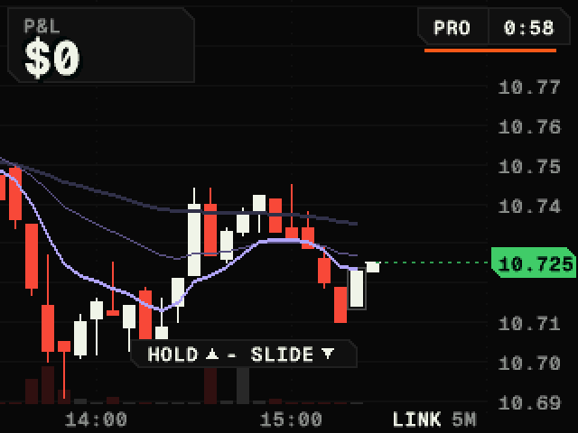
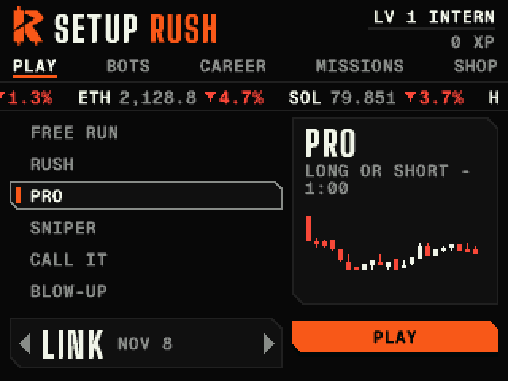
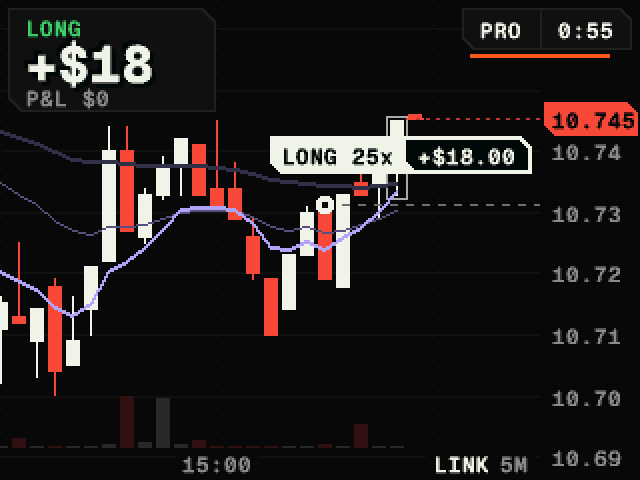
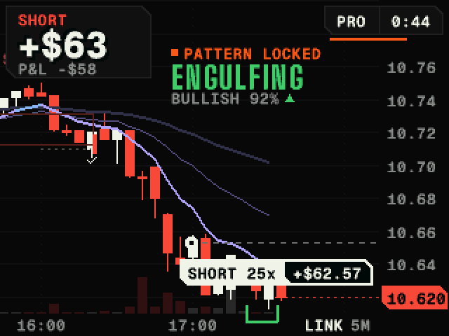
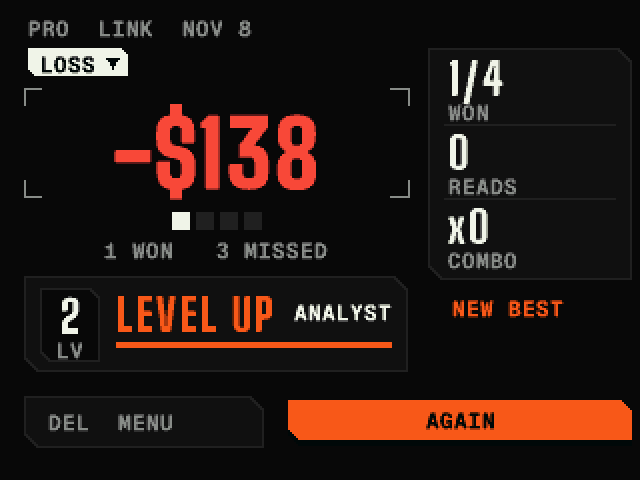
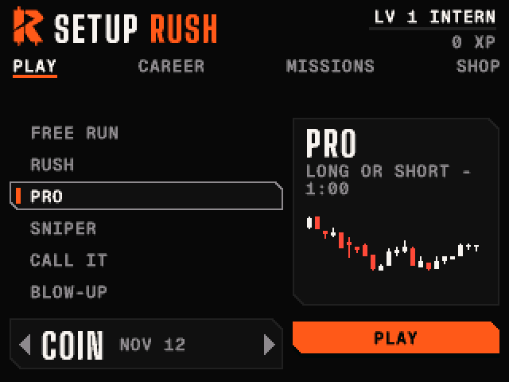
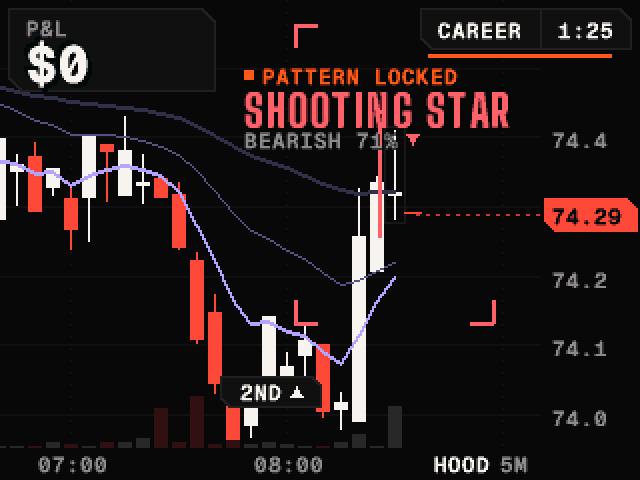
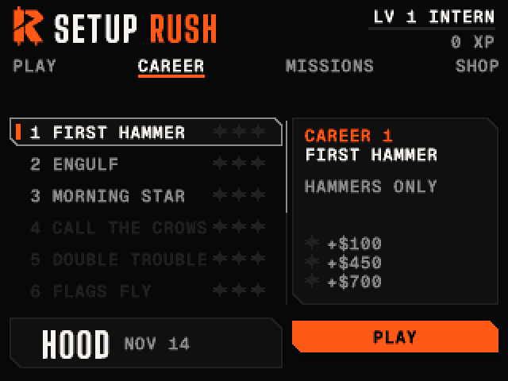
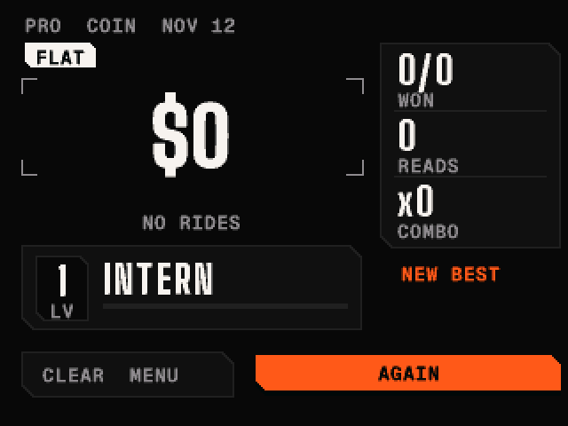

# trading-game

[](https://github.com/maxmoneycash/trading-game/actions/workflows/build.yml) [](https://maxmoneycash.github.io/trading-game/)

A trading game for calculators and handhelds: [Setup Rush](https://setuprush.com) on the TI-84 Plus CE and the
LilyGo T-Deck. Real recorded charts, one minute a round: hold to ride long, slide to go short, let go to cash out.

**[Play it in your browser →](https://maxmoneycash.github.io/trading-game/)** (the T-Deck build, compiled to WebAssembly)

<p align="center"></p>

## T-Deck

| | |
|---|---|
|  |  |
|  |  |

Hold the screen or W to ride long, slide down or hold S to go short, let go to cash out. Bots that trade an
indicator for you (or race you), Career, Missions, a Shop of themes and chart styles (line, emoji candles), and a
recap of every ride at the end of the round.

## TI-84 Plus CE

| | |
|---|---|
|  |  |
|  |  |

Hold 2ND to ride long, DOWN to go short, let go to cash out. Same charts, modes, Career, Missions and Shop; the
calculator leaves out the bots, the market tape, the recap and the intro to fit in its RAM.

## Install

Every build run on [Actions](https://github.com/maxmoneycash/trading-game/actions/workflows/build.yml) keeps the files
(`ti84` and `tdeck` artifacts), or build them yourself (Quick start).

- **TI-84 Plus CE:** with TI Connect CE, send the [CE C libraries](https://github.com/CE-Programming/libraries/releases),
  then `SRD0.8xv`…`SRDF.8xv` and `SRFNT.8xv` to Archive and `SRUSH.8xp` to RAM. Run `Asm(prgmSRUSH)` (OS 5.3+: pick
  SRUSH in PRGM). It needs about 135 KB of free RAM, so archive your other programs first.
- **LilyGo T-Deck / T-Deck Plus:** `esptool.py write_flash 0x0 firmware.factory.bin` replaces the deck's firmware
  (back yours up first: `tdeck/tools/flash.sh` does it for you).

## How it's built

One C file is the whole game. The calculator builds it as is; the T-Deck runs the same file on a layer that copies
the calculator's graphics, keypad and file calls, so a port to another device with a small screen and a few buttons
is that layer and nothing else. The simulator is that layer on SDL2.

| Folder | |
|---|---|
| `game/` | the game (`main.c`), shared by every device |
| `ti84/` | TI-84 Plus CE build, emulator harness, USB install ([README](ti84/README.md)) |
| `tdeck/` | T-Deck firmware: the platform layer, drivers, flashing, the simulator ([README](tdeck/README.md)) |
| `data/` | the packed charts and fonts every device ships, and the tools that make them |

## Quick start

```sh
tdeck/sim/build-native.sh && (cd tdeck && .pio/sim/trading-game)   # play on your computer (SDL2)
tdeck/sim/build-web.sh                                              # the browser build (Emscripten)
cd ti84 && make && make data        # TI-84 Plus CE: bin/SRUSH.8xp + bin/*.8xv (needs CEdev)
cd tdeck && platformio run          # T-Deck: .pio/build/setup-rush/firmware.bin
```

Machine-specific tool paths go in a git-ignored `local.env` (`set -a; . ./local.env; set +a`): `CEMU_HEADLESS`,
`TI84_ROM`, `TILIBS`, `TDECK_BACKUPS`, `SETUP_RUSH_REPO`.

## License

GPL-3.0 (`LICENSE`). Fonts: Geist Mono and Big Shoulders Display, SIL Open Font License 1.1 (`data/fonts/`). Emoji candles:
[Twemoji](https://github.com/jdecked/twemoji), CC-BY 4.0.
